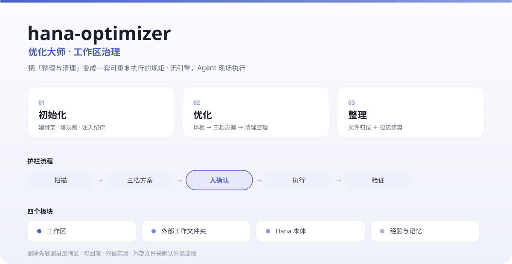

# hana-optimizer · 优化大师



> 一个面向 HanaAgent 的**工作区治理** skill：把「整理与清理」变成一套可重复执行的规矩，而不是每次拍脑袋。

## 它做什么

把工作区治理落成**三个动作**，覆盖**四个板块**。

| 动作 | 做什么 |
|---|---|
| **01 初始化** | 建目录骨架 · 落规则表 · 注入落盘纪律 · 建定时任务 |
| **02 优化** | 四板块体检 → 三档方案 → 清理 → 整理 → 写检查点 |
| **03 整理** | 文件与文件夹归位 ＋ 经验记忆修剪 |

**四个板块**：工作区 ／ 外部工作文件夹 ／ Hana 本体（`~/.hanako`）／ 经验与记忆。

## 设计原则

- **无引擎**：不依赖任何 CLI 或 App。Agent 既是"脑"也是"手"——用现场命令（`Get-ChildItem` / `Move-Item` / `Test-Path` …）扫描与搬运。
- **护栏统一**：任何动手都走 `扫描 → 分类 → 出三档方案（可现清 / 需确认 / 绝不碰）→ 人确认 → 执行 → 验证`。
- **删除先软删**：进 `_temp/反悔区/` 并写 `.manifest.jsonl`，可按原路回滚；硬删只在明确同意后做。
- **只信实测**：所有路径、文件名、版本号一律现场核对，不采信记录。
- **法域分级**：工作区可自动执行；**外部文件夹默认只读巡检**；本体"红门"绝不碰。

## 安装

1. 到本仓库 **Releases** 下载最新 `hana-optimizer.skill`；
2. 在 Hana 的扩展管理中安装该文件（或解压放入 `<HANA_HOME>/skills/hana-optimizer/`）；
3. 对 Agent 说一句「**优化大师**」。

## 使用

说「优化大师」会弹出菜单，选一个动作即可：

```
优化大师（hana-optimizer）—— 选一个动作
  01 初始化 / 02 优化 / 03 整理 / 00 功能
```

- **02 / 03 默认四板块全做**；点名某一块就只做那一块。
- 每个"需确认"的动作都会先出方案等你拍板。

## 目录结构

```
hana-optimizer/
├── SKILL.md                     入口：三个动作 / 四板块 / 护栏
├── engine/
│   └── rules.default.json       默认规则表（生命周期 / 白名单 / 保护区 / 护栏）
└── references/
    ├── 规则地图.md              每份文档讲什么、何时读
    ├── 通道与工具.md            四板块的执行通道
    ├── 自动任务模板.md          每日治理巡检的 prompt 模板（多根、按使用情况分级）
    └── rules/
        ├── README.md            规范总纲
        └── 01~08                结构与清理/整理规范
```

## 适配你的环境

本 skill 默认把 `<工作区>` 当治理主根、`<HANA_HOME>` 当本体根；外部文件夹会在运行时**动态读挂载表**（`studio-mounts.json`）自动纳入。装好后按自己机器实际路径对一下即可。

## 许可

MIT